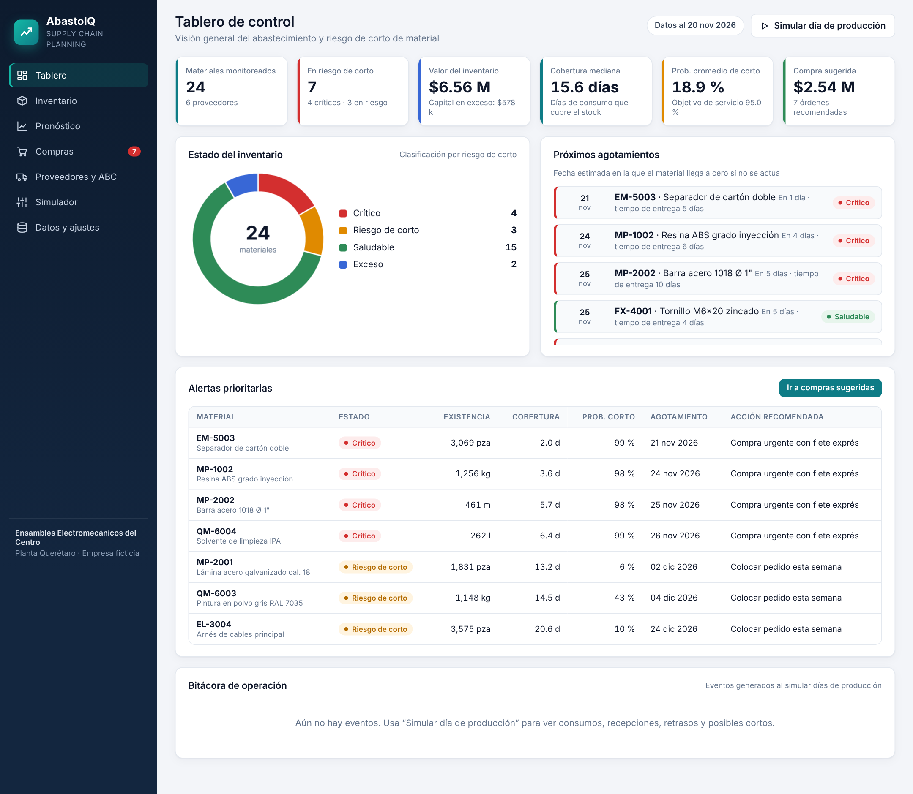
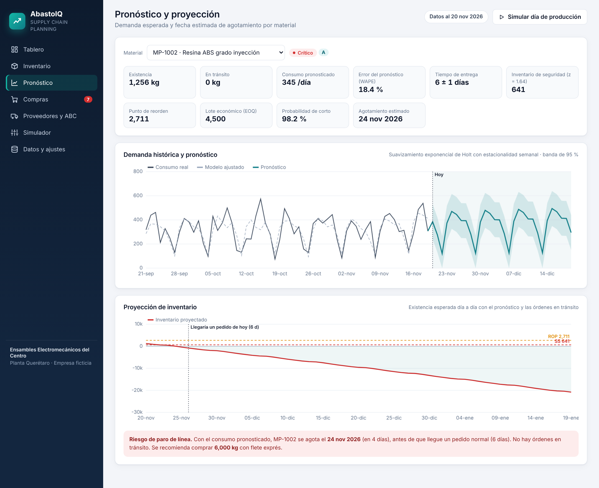

# AbastoIQ · Planeación de cadena de suministro

Aplicación web para planear la cadena de suministro, optimizar las compras y evitar cortos de material y paros de línea. Proyecto de la Unidad 2 del curso **Ingeniería de Aplicaciones para Ciencia de Datos**.

Autora: **Jessica Patricia García Moreno**



## Cómo usarla

Abre `index.html` en Chrome, Edge o Firefox. No necesita instalación, servidor ni conexión a internet. Los datos se guardan en el navegador (`localStorage`).

## Funcionalidades

| Vista | Qué hace |
|---|---|
| **Tablero** | Indicadores clave, estado del inventario, próximos agotamientos, alertas y bitácora |
| **Inventario** | Inventario de seguridad, punto de reorden, lote económico (EOQ), cobertura y clasificación ABC |
| **Pronóstico** | Demanda pronosticada con Holt y estacionalidad semanal, error del modelo y proyección diaria del inventario |
| **Compras** | Órdenes sugeridas por proveedor con fecha límite; recibir, expeditar o cancelar órdenes en tránsito |
| **Proveedores y ABC** | Evaluación de proveedores y diagrama de Pareto |
| **Simulador** | Escenarios de demanda, retraso de proveedor y nivel de servicio |
| **Datos y ajustes** | Parámetros del modelo e importación/exportación CSV |

El botón **Simular día de producción** consume material, recibe pedidos (con posibles retrasos) y registra los cortos.



## Modelo analítico

- **Pronóstico:** índices estacionales por día de la semana + suavizamiento exponencial de Holt con tendencia amortiguada (α = 0.25, β = 0.05, φ = 0.98). Error medido con WAPE.
- **Inventario de seguridad:** `SS = z · √(L·σd² + d²·σL²)`
- **Punto de reorden:** `ROP = demanda pronosticada durante L + SS`
- **Lote económico:** `EOQ = √(2·D·S / H)`, redondeado al mínimo de compra del proveedor
- **Riesgo:** *Crítico* si el material se agota antes de que llegue un pedido nuevo; *Riesgo* si la posición (existencia + tránsito) ≤ ROP.

## Estructura

```
index.html          Estructura HTML5 de la aplicación
css/styles.css      Diseño visual y adaptable
js/utils.js         Formatos, fechas y CSV
js/data.js          Datos ficticios y persistencia
js/analytics.js     Pronóstico, SS, ROP, EOQ, ABC y proveedores
js/charts.js        Gráficas en canvas
js/ui.js            Construcción de las vistas
js/app.js           Controlador: estado, navegación y eventos
docs/               Documento del entregable (U2_E1_JPGM.pdf) y capturas
```

Todos los datos de la empresa *Ensambles Electromecánicos del Centro* son ficticios.
